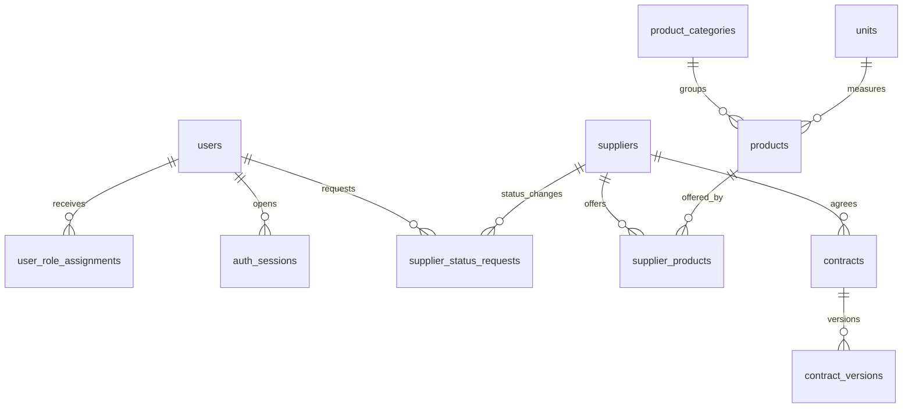
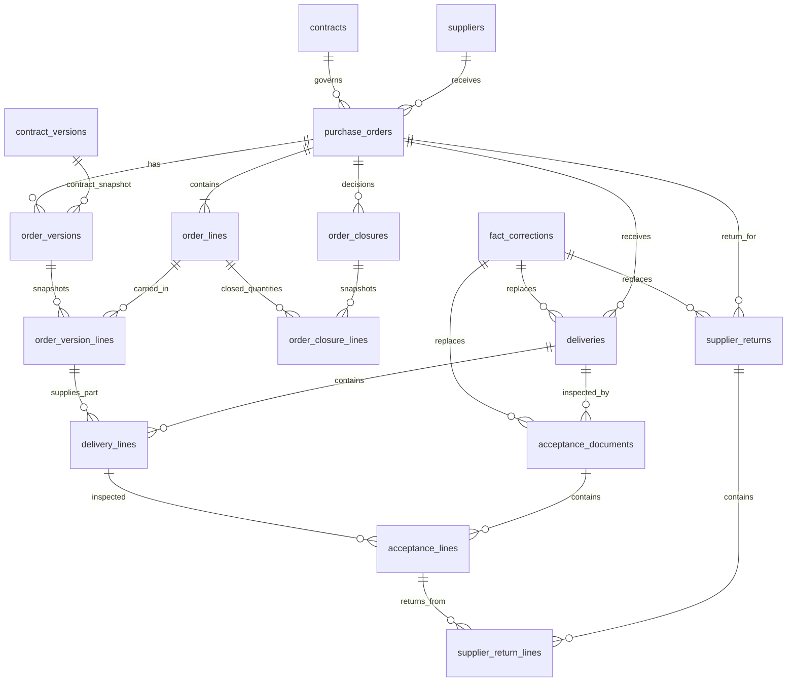
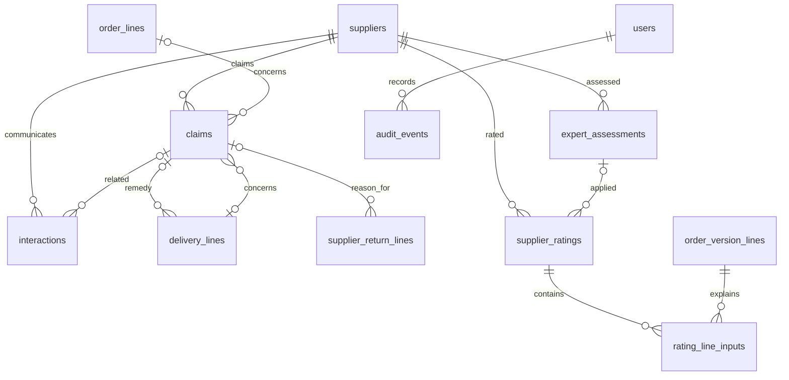

# Supplier Management v2 — карта связей целевой модели

Статус: проектное представление 30 таблиц, согласованное с `FINAL_OPTIMIZED_DATA_MODEL.md`. Диаграммы Mermaid концептуальны: перечисляют основные зависимости, но не заменяют SQL-ограничения.

## А. Пользователи, каталог, поставщики и договоры

## Б. Заказ, исполнение и корректировки

Принцип: после согласования заказа `order_version_lines` содержит **по одной строке на часть обязательства с собственным сроком**; она связана с постоянной логической строкой `order_lines`. Сегмент не нуждается в отдельной таблице.

## В. Взаимодействия, претензии, оценки, рейтинг и аудит

`audit_events` использует осмысленную пару `entity_type/entity_id` только для **журнала**; критические связи документов задаются настоящими FK.

## D. Три проверки, требующие специальных правил

1. **Согласованные версии:** `contracts.current_registered_version_id` должен указывать на `contract_versions` того же договора; `purchase_orders.current_approved_version_id` — на `order_versions` того же заказа. Достаточно обычного FK недостаточно; используем составной FK либо проверку в транзакции и ограничение БД.
2. **Один открытый запрос:** на поставщика — только один `supplier_status_requests` в `PENDING`; на заказ — одна `order_versions` в `PENDING` (с учётом разрешённых черновиков). На PostgreSQL — частичные уникальные индексы.
3. **Приёмка и возврат:** по `delivery_lines` суммарно подтверждённая приёмка не превышает фактическую поставку; по `acceptance_lines` суммарные подтверждённые возвраты не превышают принятого количества. Это агрегатные транзакционные инварианты, а не CHECK одной строки.
